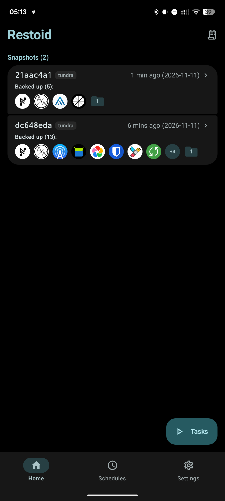
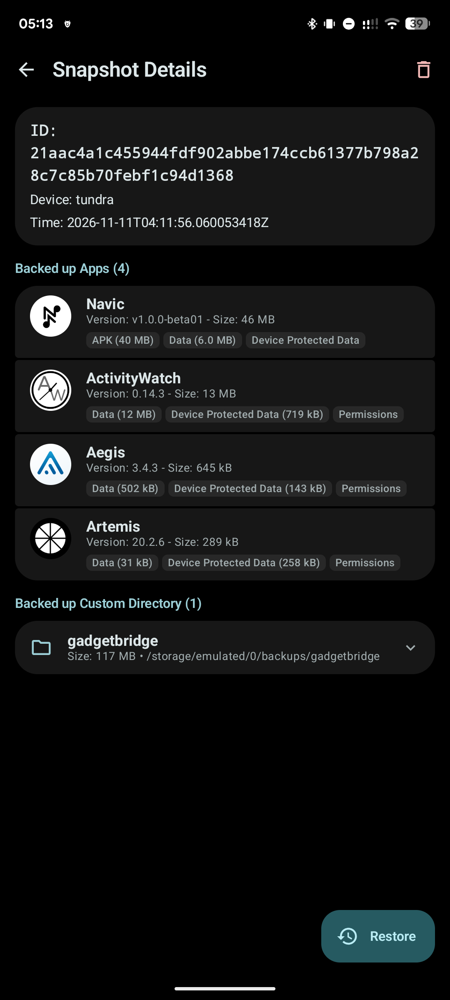
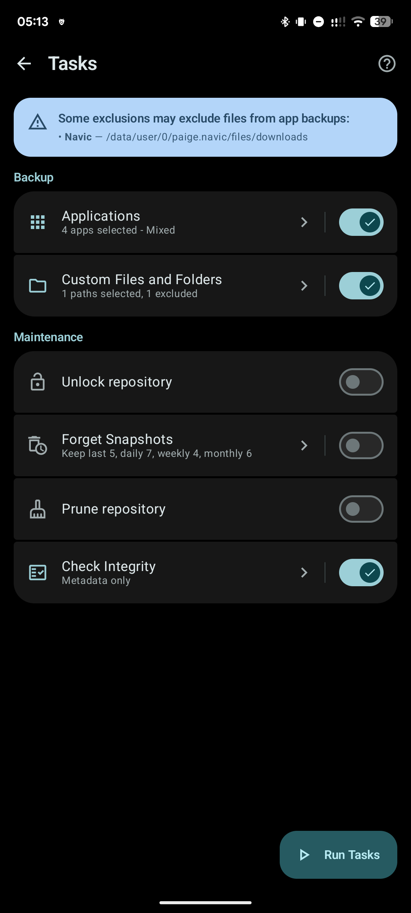

# Restoid
Android backup tool powered by [`restic`](https://github.com/restic/restic/).

Restoid gives you control over your backups through a clean and simple user interface. It's built for users who want robust, encrypted, and deduplicated backups.

## 📥 Download

  &nbsp;
  &nbsp;
  

  Official F-Droid updates may be delayed. For instant updates directly from CI, <a href="https://fdroid.link/#https://hddq.github.io/restoid/fdroid/repo?fingerprint=E6629E27D6CDC87B15F68C43F7D7DF8904AC8EFC76D87C7903976C3A38233AC5">add the custom repository</a>

## 📸 Screenshots

  
  
  

## ✨ Features

* **Restic-Powered**: Leverages the speed, security, and efficiency of `restic` for deduplicated and encrypted backups.
* **Selective App Backup**: Choose exactly which user-installed applications you want to back up (requires root).
* **Full Control Over What You Back Up**: Granularly select what to include for each app: APK files, user data, device-protected data, external/OBB/media files (requires root).
* **Custom Directory Backup**: Back up custom directories and files like DCIM, Documents, etc.
* **Flexible Repository Management**: Create and manage repositories across native restic backends: Local directory, SFTP, REST server, and Amazon S3/MinIO.
* **Snapshot Management**: Easily browse backup snapshots, view details of what was backed up, and forget old snapshots.
* **Flexible Restore**: Restore entire apps or just specific parts (like only app data).
* **Automated Schedules**: Set up recurring backups with customizable intervals and trigger conditions (battery, charging, and network status).
* **Downgrade Protection**: Prevents you from accidentally restoring an older app version over a newer one (can be overridden).

## ⚠️ Requirements

* **Root Access (Optional)**: Root access is only required if you want to back up apps and their data.
* **Android Version**: Minimum SDK 29 (Android 10), but SDK 37 (Android 17) is recommended.

## 🤝 How to Contribute

If you find a bug, have a feature request, or want to help clean up the code, please:

1.  **Open an issue** to discuss the change.
2.  Fork the repository and submit a pull request.

All contributions are welcome!

## 🌐 Translations

Translations for Restoid are managed via Crowdin. If you'd like to help translate the app into your language, [please visit the project page](https://crowdin.com/project/restoid).

### 🌍 How to contribute translations:

- Create an account on [Crowdin](https://crowdin.com/) (if you don't already have one).
- Join the Restoid project, pick a language, and translate strings using Crowdin's web editor.
- Translated strings are automatically synchronized with the repository via GitHub Actions.

## 📜 License

This project is licensed under the **GNU General Public License v3.0**. See the `LICENSE` file for details.
